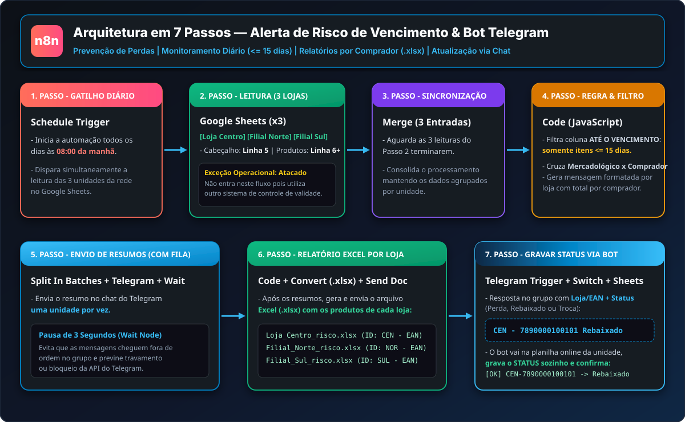
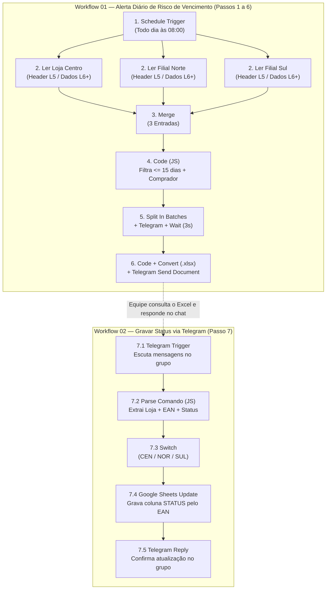

# Automação de Alerta de Risco de Vencimento e Bot Operacional (n8n + Telegram + Google Sheets)

Pipeline de automação e bot interativo desenvolvido no **n8n** para a rotina diária de **prevenção de perdas e controle de validade** em uma rede de supermercados (3 unidades monitoradas em paralelo). A solução lê diariamente as planilhas de auditoria no **Google Sheets**, filtra produtos em risco crítico de vencimento (**<= 15 dias**), agrupa as pendências por **comprador responsável**, envia alertas e relatórios `.xlsx` no **Telegram** e permite que a operação **atualize o status do item na planilha online respondendo diretamente pelo grupo do Telegram**.

> **Nota de confidencialidade:** todos os dados, nomes de compradores, nomes de filiais, códigos de barras, identificadores de planilhas e parâmetros operacionais presentes neste repositório são 100% fictícios, criados exclusivamente para demonstração de arquitetura e portfólio. Os dados reais da operação são confidenciais e estão protegidos — nenhuma credencial de acesso, token de API ou dado real de terceiros foi incluído aqui.

---

## Visão Geral

No dia a dia do varejo alimentar, acompanhar produtos próximos do vencimento em múltiplas lojas costuma depender de conferências manuais em planilhas separadas e cobranças dispersas em grupos de mensagens. Esta solução transforma esse processo em um fluxo fechado (*end-to-end*):

1. **Coleta e alerta ativo (08:00h):** o robô varre as planilhas de auditoria das 3 lojas simultaneamente, identifica o que vence nos próximos 15 dias, atribui cada item ao comprador dono daquele setor mercadológico e publica no Telegram tanto o resumo gerencial quanto o Excel detalhado de cada loja.
2. **Retorno operacional pelo próprio chat:** ao tomar uma ação sobre o produto (ex.: *Rebaixado*, *Troca* ou *Perda*), a equipe apenas envia o código no grupo do Telegram (`SIGLA - EAN Status`) e o bot atualiza automaticamente a coluna `STATUS` na planilha online correspondente.

## Contexto de Negócio

Prevenção de perdas por validade vencida é uma das alavancas mais diretas de proteção de margem no varejo supermercadista. Quando um item entra na janela crítica de **15 dias para o vencimento**, a velocidade de reação entre a auditoria de loja e o comprador comercial define se aquele estoque será escoado (via rebaixa de preço ou negociação de troca com o fornecedor) ou se virará perda direta no resultado.

## O Problema que Resolve

- **Conferência manual em múltiplas planilhas:** abrir loja por loja todos os dias para filtrar datas de vencimento consome tempo e atrasa a ação comercial.
- **Falta de direcionamento por responsável:** listas gerais de vencimento sem separação por comprador geram difusão de responsabilidade.
- **Atrito para atualizar o status do item:** exigir que o operador ou comprador abra a planilha no computador apenas para dar baixa em um item reduz a adesão ao controle.
- **Desorganização e bloqueio de API no envio de alertas:** disparos simultâneos sem controle de fila misturam mensagens de lojas diferentes no chat.

## Público e Decisões Apoiadas

- **Compradores Comerciais:** recebem às 08h00 o volume exato de itens críticos sob sua responsabilidade em cada loja, priorizando negociações de troca ou ações promocionais de queima.
- **Prevenção de Perdas e Auditoria de Loja:** acompanham os relatórios padronizados em `.xlsx` e registram o desfecho de cada item (*Rebaixado*, *Troca*, *Perda*) direto pelo celular no Telegram.
- **Gerência Operacional:** visualiza diariamente o volume de risco por filial e por carteira de compras.

## Impacto e Valor Gerado

- Elimina a triagem manual diária de planilhas de validade nas unidades.
- Direciona automaticamente cada produto em risco (<= 15 dias) ao comprador responsável pelo setor mercadológico.
- Garante entrega organizada no Telegram com controle de fila (*rate limit* de 3 segundos entre lojas).
- Fecha o ciclo operacional permitindo atualizar a planilha do Google Sheets via comando simples no chat do Telegram.

---

## Arquitetura do Fluxo (Os 7 Passos)



### Passo a Passo Técnico

| Etapa | Nodes do n8n | Funcionamento na Prática |
| :---: | :--- | :--- |
| **1° Passo** | `Schedule Trigger` | **Gatilho Diário:** Inicia a automação todos os dias às **08:00 da manhã**. |
| **2° Passo** | `Google Sheets` *(x3)* | **Leitura Simultânea das 3 Lojas:** Busca em paralelo as planilhas das unidades **Loja Centro**, **Filial Norte** e **Filial Sul**, lendo sempre o cabeçalho na **linha 5** e os produtos a partir da **linha 6**. *(Nota operacional: a unidade Atacado não entra neste fluxo pois utiliza outro sistema de controle de vencimento).* |
| **3° Passo** | `Merge (3 entradas)` | **Sincronização:** Faz um *merge* das 3 entradas do Passo 2, aguardando todas as leituras terminarem antes de processar e juntar as informações organizadas por loja. |
| **4° Passo** | `Code (JavaScript)` | **Filtro de Risco e Cruzamento por Comprador:** Analisa a coluna `ATÉ O VENCIMENTO` de cada produto, filtra somente os itens com **<= 15 dias**, cruza a coluna `MERCADOLÓGICO` com o comprador responsável e monta a mensagem de resumo formatada para cada loja. |
| **5° Passo** | `Split In Batches` + `Telegram` + `Wait` | **Envio de Resumos com Controle de Fila:** Envia o resumo no grupo do Telegram **uma loja por vez**, aplicando um tempo de espera de **3 segundos** (`Wait`) entre cada envio para não virar bagunça no chat e evitar travamento (*rate limit*) da API do Telegram. |
| **6° Passo** | `Code` + `Convert to File (.xlsx)` + `Telegram (Send Document)` | **Geração e Envio do Excel por Loja:** Logo após os resumos em texto, gera e envia no grupo os arquivos `.xlsx` detalhados com os produtos em risco de cada loja (`Loja_Centro_risco.xlsx`, `Filial_Norte_risco.xlsx` e `Filial_Sul_risco.xlsx`), já com o `ID` formatado (`CEN - EAN`, `NOR - EAN`, `SUL - EAN`). |
| **7° Passo** | `Telegram Trigger` + `Code` + `Switch` + `Google Sheets (Update)` | **Gravação Automática de Status via Telegram:** Quando alguém responde no grupo com a sigla/EAN e o novo status (*Perda*, *Rebaixado* ou *Troca*), o bot interpreta a mensagem, identifica a loja, localiza o código de barras na planilha online correspondente, grava a informação na coluna `STATUS` sozinho e responde confirmando no grupo. |

### Fluxograma de Arquitetura (Mermaid)



---

## Regra de Negócio: Mapa de Compradores por Setor (Dados Fictícios)

No **4° e 6° passos**, o código JavaScript vincula automaticamente cada item ao comprador responsável com base na coluna `MERCADOLÓGICO`:

| Comprador (Fictício) | Setores Mercadológicos Atribuídos |
| :--- | :--- |
| **Carlos** | `001 - Merc. Salgada`, `004 - Saúde e Estética`, `006 - Limpeza`, `010 - Pet Shop`, `020 - Tabacaria` |
| **Fernanda** | `002 - Merc Doce`, `007 - Higiene e Perfumaria`, `009 - Bazar`, `016 - Cereais` |
| **Rafael** | `003 - Bebidas`, `014 - Açougue` |
| **Lucas** | `005 - Frios e Laticínios`, `022 - Peixaria` |
| **Beatriz** | `008 - Horti Fruti`, `011 - Restaurante`, `012 - Padaria Própria`, `015 - Padaria Terceirizada`, `021 - Sushi` |
| **Não Atribuído** | Qualquer setor não mapeado na lista acima |

---

## Exemplo Prático de Operação no Telegram

### 1. Alerta de Resumo Diário (Passo 5)
```text
[LOJA CENTRO] — 14 item(ns) em risco (<= 15 dias)
---------------------------------------------
Por comprador:
- Beatriz: 5
- Carlos: 3
- Fernanda: 2
- Lucas: 1
- Rafael: 3

Detalhamento completo no Excel em anexo.
```

### 2. Colunas do Arquivo Excel Gerado (Passo 6)
Cada planilha `.xlsx` enviada no grupo contém a aba `Risco` com a estrutura abaixo:

| ID | CÓDIGO EM BARRA | PRODUTO | COMPRADOR | QUANTIDADE | VENCIMENTO | DIAS RESTANTES | STATUS ATUAL |
| :--- | :--- | :--- | :--- | :---: | :---: | :---: | :--- |
| `CEN - 7890000100101` | `7890000100101` | `BISCOITO RECHEADO CHOCOLATE 140G` | `Fernanda` | `24` | `25/10/2026` | `6` | *(em branco)* |

### 3. Atualização de Status pelo Grupo (Passo 7)
Para atualizar a planilha sem precisar abrir o Google Sheets, basta enviar no grupo:
```text
CEN - 7890000100101 Rebaixado
```
*(Status aceitos pelo parser: `Rebaixado`, `Troca` ou `Perda`)*. O bot grava na planilha da loja e responde na mesma mensagem:
```text
[OK] CEN-7890000100101 -> Rebaixado
```

---

## Estrutura do Projeto

```text
workflows/
  ├── 01-alerta-risco-vencimento-telegram.json   -> Workflow principal (Passos 1 a 6: agendamento, leitura, resumo e Excel)
  └── 02-gravar-status-via-telegram.json         -> Workflow do bot interativo (Passo 7: leitura do chat e update no Sheets)
docs/
  └── arquitetura-workflow.svg                   -> Diagrama visual da arquitetura em 7 passos
data_exemplo/
  └── exemplo_relatorio_risco.csv                -> Exemplo fictício da estrutura do relatório de risco gerado (.xlsx)
LICENSE                                          -> Licença proprietária de visualização restrita (Portfólio)
README.md                                        -> Documentação técnica e de negócio do projeto
```

## Stack

n8n (Workflow Automation) - JavaScript (Node.js Code Nodes) - Google Sheets API - Telegram Bot API - Automação de Planilhas (`.xlsx`).

## Como Usar

1. No seu ambiente **n8n**, clique em **Import from File** e importe os dois arquivos da pasta `workflows/`:
   - `workflows/01-alerta-risco-vencimento-telegram.json`
   - `workflows/02-gravar-status-via-telegram.json`
2. Configure as suas credenciais do **Google Sheets OAuth2 API** e do **Telegram Bot API** nos respectivos nós.
3. Substitua os IDs das planilhas (`documentId`) e o `chatId` do grupo do Telegram pelos identificadores do seu ambiente e ative os workflows.

## Autor

José Vitor Santos Pinheiro — Análise de Dados e Inteligência Comercial (Varejo, Indústria e Distribuição).
Contato: vytorsantt@gmail.com
